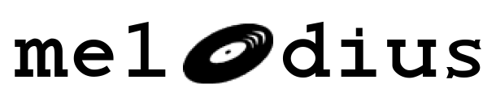

<div align="center">
    <br>
</div>

---

* Focus on transcribing accurate melodies from provided media and produce clear and accurate MIDI's 
* Powered by SheetSage2

## Requirements

- node.js or bun
- [uv](https://docs.astral.sh/uv/)
- `ffmpeg`

## Run locally
```bash
npm/bun install
npm/bun run dev
```

### Transcribe a URL
```bash
curl -X POST http://127.0.0.1:8000/transcribe \
  -F "url=https://example.com/audio-or-video"
```

The response includes a job identifier and a URL for the generated MIDI file.

## Commands

```bash
npm run dev       # Start frontend and API
npm run dev:web   # Start only Vite
npm run dev:api   # Start only the API
```


